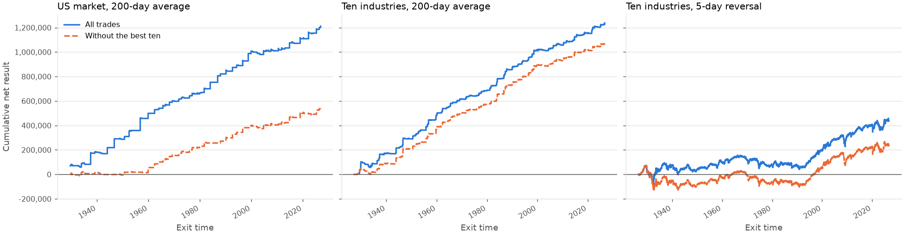

# Coroner

Give it a list of closed trades. It reports what the profit rests on.

## The result

The question: when a trade log made money, did it come from a broad edge or from a few trades, and does the usual per-trade t-statistic tell you which?

I ran Coroner on three trade logs from plain rules applied to Ken French's daily US returns, July 1926 to September 2026. Each trade pays a flat 10 basis points of notional for the round trip.

| | US market, 200-day average | Ten industries, 200-day average | Ten industries, 5-day reversal |
|:--|--:|--:|--:|
| Trades | 282 | 3,230 | 5,267 |
| t-statistic, trades independent | 4.87 | 12.56 | 1.90 |
| t-statistic, clustered by exit month | 4.86 | 8.34 | 1.90 |
| Share of profit in the best 10 | 54.6% | 12.8% | 45.7% |
| The same for a Normal log with this mean and sd: median, p | 30.0%, 0.010 | 4.6%, 0.0005 | 24.0%, 0.19 |
| The same for these trades with random signs: median, p | 40.6%, 0.067 | 11.3%, 0.090 | 45.5%, 0.50 |
| t-statistic without the best 10 | 4.06 | 12.71 | 1.07 |
| Best trades to remove before the total reaches zero | 31 | 221 | 28 |
| The same for a Normal log: median, p | 46, 0.10 | 374, 0.0005 | 50, 0.23 |
| The same for these trades with random signs: median, p | 73, 0.019 | 677, 0.0005 | 29, 0.49 |
| Share of profit in the best 5% of trades | 71.4% | 87.1% | 459.8% |
| Cost share of gross | 2.3% | 2.5% | 54.5% |

What it found:

- Both trend rules made money across the whole century, and neither depends on a handful of trades. Removing the best ten leaves a t-statistic above 4.
- By the share in the best ten, their profit is more concentrated than a Normal log with the same mean and spread would give (p = 0.010 and 0.0005). Against the same trades flipped about their mean with random signs, which keeps the fat tails and removes the skew, neither p is below 0.05 (0.067 and 0.090). The count of best trades that must go before the total reaches zero is stricter. Against the flipped trades it is low for both rules (p = 0.019 and 0.0005), and in the industry rule the best 5% of trades carry 87.1% of the profit. The profit rests on the right tail of many trades, which a rule that cuts losers and keeps winners should produce.
- For the industry rule the plain t-statistic overstates the evidence. Its 3,230 trades close on 2,577 distinct days and in 799 months, and clustering by exit month takes t from 12.56 to 8.34. For the single-market rule, whose trades never overlap, clustering changes almost nothing.
- The 5-day reversal is within two standard errors of zero after costs (t = 1.90), costs take 54.5% of its gross profit, and it made 78,164 in its first half and 361,412 in its second. Its best ten trades carry 45.7% of the profit, which is ordinary for a log this noisy.



The main limit: the three rules are examples, picked for being simple, and a flat 10 basis points is too cheap for the 1930s. The concentration test is also weak when a few trades are huge, because those trades inflate the standard deviation the null is drawn with. The synthetic log below, where ten trades carry 99% of the profit, gets p = 0.12. See Limits.

Full reports: [market](results/real/market_ma200/report.md), [industries, 200-day](results/real/industry_ma200/report.md), [industries, reversal](results/real/industry_reversal/report.md). All numbers are in `results/summary.md`.

## The synthetic logs

`samples/` holds two synthetic logs that the tests use as fixtures. They are random numbers, built to differ, and say nothing about any market. Each has 400 trades and made exactly 20,000.00. In `broad.csv` the trades are draws from one Normal distribution. In `concentrated.csv` ten trades carry 99.0% of the profit, and sixty trades sit in the first half hour of the day with a median hold of 3.2 minutes.

| | broad | concentrated |
|:--|--:|--:|
| t-statistic | 3.98 | 2.40 |
| Share of profit in the best 10 | 31.7% | 99.0% |
| The same for a Normal log: median, p | 31.6%, 0.50 | 50.8%, 0.12 |
| t-statistic without the best 10 | 2.93 | 0.04 |
| Best trades to remove before the total reaches zero | 42 | 11 |
| Permutation p, time of day | 0.93 | 0.0005 |

The broad log sits at the middle of its Normal null, as it should. The concentrated one does not stand out against its null: at t = 2.4 a Normal log's best ten trades carry about half the profit anyway. What separates the two is the t-statistic once the best ten are gone (0.04 against 2.93) and the time-of-day test. Reports: [broad](results/synthetic/broad/report.md), [concentrated](results/synthetic/concentrated/report.md); table: `results/synthetic/summary.md`.

## Reproduce

```
uv sync
uv run python scripts/fetch_data.py
uv run python scripts/reproduce.py
uv run pytest
```

`fetch_data.py` downloads two zip files from the Ken French data library into `data/`, which git ignores. They are free and need no key. `reproduce.py` rebuilds the three logs in `logs/` from them, then every report, chart and table in `results/`. It takes under two minutes. Without `data/` it uses the committed logs. `results/data_used.md` records the SHA-256 and date range of the files used. The library rebuilds its files from each new CRSP release, so a later download can change the logs. The committed ones come from the files built on the September 2026 release. `--fast` uses fewer paths and draws, for CI.

## Use it on your own trades

```
uv run coroner report trades.csv
```

This writes `trades-report/report.md`, `trades-report/report.html` and `trades-report/figures/`. The HTML file has its styles and charts embedded and needs nothing else. The verdict is also printed to the terminal.

The input is a CSV with one row per closed trade.

| Column | Required | Meaning |
|:--|:--|:--|
| `entry_time` | yes | ISO 8601, for example `2025-03-10T09:31:00-04:00` or `2025-03-10 09:31:00` |
| `exit_time` | yes | ISO 8601, not before `entry_time` |
| `gross` | yes | result before costs, in account currency |
| `net` | yes | result after costs |
| `symbol` | no | free text; adds a by-symbol table |
| `side` | no | `long` or `short` (`buy` and `sell` are accepted); adds a by-side table |
| `size` | no | positive number; the median is reported |

Column names are matched after trimming spaces and lower-casing, and other columns are ignored. Timestamps must all carry a UTC offset or all carry none. With offsets, the time of day is taken as written in the file, or converted with `--tz America/New_York`. Without offsets the times are used as written. Holding times always come from the true instants, so a daylight-saving change does not distort them. At least two trades are needed.

A file that breaks these rules is rejected with the row and the reason, for example `row 17: exit_time '2025-03-10T09:00:00' is before entry_time '2025-03-10T09:31:00'`, and the exit code is 2.

Options, with their defaults:

| Option | Default | Meaning |
|:--|:--|:--|
| `--out DIR` | `<file stem>-report` | output directory |
| `--tz ZONE` | none | convert timezone-aware timestamps to this zone |
| `--capital` | 100000 | starting equity; percentage drawdowns depend on it |
| `--best-n` | 10 | how many of the best trades to leave out |
| `--bucket-minutes` | 60 | width of time-of-day buckets |
| `--short-hold-minutes` | 5 | a bucket is flagged when its median hold is below this |
| `--min-bucket-trades` | 20 | and it has at least this many trades |
| `--target`, `--loss-limit` | 10% of capital each | the two barriers, as positive amounts |
| `--horizon` | number of trades in the file | trades per resampled path |
| `--paths` | 10000 | resampled paths |
| `--draws` | 2000 | permutation draws, and draws for each concentration null |
| `--block` | 10 | mean block length of the stationary bootstrap, in trades |
| `--risk-free` | 0 | percent a year, for the Martin ratio |
| `--seed` | 0 | the same file, settings and seed give the same report |

## What was built

Ten checks, each a pure function in `src/coroner/checks.py` or `src/coroner/barrier.py` with its own tests.

1. Per-trade mean, standard deviation (n - 1) and t-statistic, mean / sd x sqrt(n).
2. The same t-statistic with a cluster-robust standard error, with trades grouped by exit day and by exit month. Trades in one cluster may be correlated in any way; clusters are taken as independent.
3. A label-shuffle permutation test. The statistic is the between-group sum of squares of net results grouped by time-of-day bucket, and again by weekday. Labels are shuffled 2,000 times with a fixed seed.
4. First half against second half, in exit-time order, split by count.
5. Profit by entry time-of-day bucket and by weekday, with the median holding time of each bucket and a flag for short holds.
6. Leave-out: total, mean and t-statistic without the best N trades and without the best 5%, the share of profit those trades carried, and the smallest number of best trades whose removal takes the total to zero or below.
7. Concentration against two nulls. The best-N share and the trades-to-zero count are computed for 2,000 logs of the same length drawn two ways: from a Normal with the log's mean and standard deviation, and by resampling the trades and reflecting each about the mean with a random sign. The report gives the null median, the 95th (or 5th) percentile and a one-sided p-value.
8. Cost share: total cost over total gross result. When gross is zero or negative the share is reported as not defined.
9. Ulcer index, Martin ratio, maximum drawdown, longest time under water and recovery factor. Recovery factor (net profit over maximum drawdown) is a trading-platform convention. I found no source for it in the literature.
10. Share of days, months and quarters that ended positive, and the chance of reaching a profit target before a loss limit. For the second, trades are resampled by the i.i.d. bootstrap and by the stationary bootstrap, each path's running total is followed, and paths that reach neither barrier are reported separately. The Brownian closed form is printed beside them.

### The verdict rules

The verdict is three to five sentences. Each comes from one fixed rule in `src/coroner/verdict.py`.

1. Headline, always: trade count, net total, mean and t-statistic, and whether |t| is at least 2.
2. Concentration, always. The share of profit in the best N trades beside the Normal null's median and p. When p is below 0.05 it says "N trades carry X% of the profit" and what the others made. Otherwise it says how many of the best trades must go before the total reaches zero. If the log lost money it says there is no profit to attribute.
3. Halves, always: what each half made or lost.
4. Time, only when triggered. If a time-of-day bucket is flagged for short holds, the flagged bucket with the largest absolute profit is named. Otherwise, if a permutation test has p below 0.01, that is stated.
5. Costs, only when triggered: costs are at least half of gross, or gross is not positive.

The concentration rule used to fire when the best N carried half the profit or more. That cut-off had no reference point: the share a log puts in its best ten depends on its length and its t-statistic. The p-value against the Normal null replaces it.

## Sources

- Peter G. Martin and Byron McCann, The Investor's Guide to Fidelity Funds, Wiley, 1989 (the ulcer index). I read Martin's own statement of the formula at tangotools.com/ui/ui.htm, not the book.
- Dimitris N. Politis and Joseph P. Romano, "The Stationary Bootstrap", Journal of the American Statistical Association 89(428), 1994, 1303-1313. The JASA text is paywalled. The algorithm was taken from the same authors' "Limit theorems for weakly dependent Hilbert space valued random variables with application to the stationary bootstrap", Statistica Sinica 4, 1994, Section 3.1.
- Karl Sigman, lecture notes on Brownian motion and on the gambler's ruin problem, Columbia University, for the two closed forms.
- Kenneth R. French, Data Library, Fama/French 3 Factors (daily) and 10 Industry Portfolios (daily), for the real logs.

`PAPER.md` has each formula with its location in the source.

## Comparison with the sources

There is no paper result to replicate here. The comparison is between the barrier simulator and the closed forms it should agree with (`results/barrier_check.md`):

| Case | Paths | Exact | Simulated | Difference | z |
|:--|--:|--:|--:|--:|--:|
| Fair +-1 walk, target 15, limit 10 | 1,000,000 | 0.40000 | 0.40009 | +0.00009 | +0.19 |
| +-1 walk, p = 0.55, target 10, limit 10 | 1,000,000 | 0.88150 | 0.88118 | -0.00032 | -1.00 |
| +-1 walk, p = 0.45, target 10, limit 10 | 1,000,000 | 0.11850 | 0.11882 | +0.00032 | +0.98 |
| Gaussian steps, sd 0.5, target 15, limit 10 | 100,000 | 0.52155 | 0.52621 | +0.00466 | +2.95 |
| Gaussian steps, sd 0.25, target 15, limit 10 | 100,000 | 0.52155 | 0.52329 | +0.00174 | +1.10 |

The three +-1 walks agree with the gambler's ruin formula to within one standard error at a million paths each. An earlier run at 20,000 paths had the p = 0.45 walk 2.7 standard errors low; at a million paths it is one standard error high, so that was chance. The Gaussian rows are expected to sit above the Brownian value: a discrete step overshoots the barrier, and the gap shrinks from +0.0047 to +0.0017 when the step is halved.

The ulcer index and the Martin ratio differ from Martin's statement in three small ways, listed in `PAPER.md`.

## How it is tested

147 tests, the maths first. One of them needs the downloaded data and is skipped without it, as in CI.

- Exact algebra on small hand-built inputs for every check, with the arithmetic written in a comment beside each expected value
- The clustered t-statistic by hand, equal to the plain one with one trade per cluster, and lower when trades in a cluster move together
- The concentration null: p-values near uniform on logs drawn from the null itself, and a small p for a log with five winners of twelve standard deviations
- The ulcer index against the loop printed on Martin's page
- The barrier simulator against a/(a+b) for a fair +-1 walk, the gambler's ruin formula for a biased one, and the Brownian closed form for Gaussian steps
- The permutation test: mean p near 0.5 over 300 data sets whose labels carry no information, and the exact p of 2/70 on a case small enough to enumerate
- The stationary bootstrap: blocks follow on and wrap, block lengths have the stated mean, a mean block of 1 gives independent draws
- The strategies: the moving-average rule never uses the close it trades on, and trades, reversal picks and costs by hand
- The loader: every rejection names its row; timezone handling across a daylight-saving change
- Each verdict rule against the exact sentence it must produce
- Running `reproduce` twice gives byte-identical files, the committed summary tables match what the code produces from the committed logs, and the committed logs match the downloaded data

## Layout

```
src/coroner/trades.py      read and validate the CSV
src/coroner/checks.py      the checks
src/coroner/barrier.py     target before loss limit, and the closed forms
src/coroner/analysis.py    runs every check
src/coroner/verdict.py     the verdict rules
src/coroner/report.py      markdown and HTML
src/coroner/charts.py      the figures
src/coroner/strategies.py  the three public-data rules that make logs/
src/coroner/samples.py     the two synthetic logs
src/coroner/cli.py         the command line
tests/                     maths tests first
scripts/fetch_data.py      downloads the Ken French files into data/
scripts/reproduce.py       rebuilds logs/ and results/
scripts/make_samples.py    rewrites samples/
logs/                      trade logs from the three rules
samples/                   the two synthetic logs
results/real/              reports on the three logs
results/synthetic/         reports on the two synthetic logs
PAPER.md                   citations, formulas, differences from the sources
```

Dependencies are numpy, pandas and matplotlib. The command line uses `argparse` from the standard library.

## Limits

- The three rules are examples. I picked them for being plain and well known, decided the rules, sizes and cost in this revision before running Coroner on the logs, and ran each once. Git history cannot show that order. Other windows or costs would give other numbers.
- The cost is a flat 10 basis points of notional per round trip in every year. Trading an industry portfolio in 1930 cost far more, and there was no index fund to trade. The reversal log is the one this matters for, since costs already take 54.5% of its gross.
- The concentration nulls use the log's own standard deviation. A few huge trades inflate it, which widens the null and hides those same trades. The synthetic concentrated log shows it: 99% of the profit in ten trades, p = 0.12. Read the share beside the t-statistic without the best trades.
- The reflected null removes skew but keeps the trades' tails. A trend rule cuts losers and keeps winners, so its trades are skewed by design, and a small p there is a property of the rule.
- The clustered t-statistic groups trades by exit day or month. Trades that overlap but close in different months are still treated as independent, so the clustered figure for the industry rule may still be high. With few clusters (the synthetic logs have 12 months) the clustered standard error is itself noisy, and there it came out above the plain one.
- The t-statistic did not catch the synthetic concentrated log: 2.40 with ten trades carrying 99% of the profit. The barrier odds did not either: resampling gave it a 92.1% chance of reaching +10,000 before -10,000, because the bootstrap deals the ten large winners back in at the rate they occurred.
- The stationary bootstrap's mean block of 10 trades is a default I picked, not estimated from the data.
- Percentage drawdowns, the ulcer index and the Martin ratio depend on `--capital`. The default of 100,000 is arbitrary, and the real logs use fixed trade sizes without compounding, so their annual return and Martin ratio describe that bookkeeping and little else.
- The ulcer index is computed on end-of-day equity over every calendar day, weekends included. Equity moves only when a trade closes, so open-trade losses are invisible and every drawdown figure is a lower bound. On the real logs, whose trades last up to years, that matters.
- The real logs carry dates only, so the time-of-day checks have one bucket and do not run.
- The short-hold flag uses fixed thresholds (median under 5 minutes, at least 20 trades). It marks a window to look at. It does not show that the fills were unrealistic.
- The permutation tests cover two labelings. With two tests the verdict uses p below 0.01, which is a rough allowance and not a formal correction.
- It judges the trades you give it. It cannot see the versions you tried and threw away; [Procrustes](https://github.com/mal0ware/procrustes) is for that.
- This is research code. It is not investment advice and it does not trade.

A coroner finds the cause of death; this one looks for the cause of a profit.

## Licence

MIT. See `LICENSE`.
