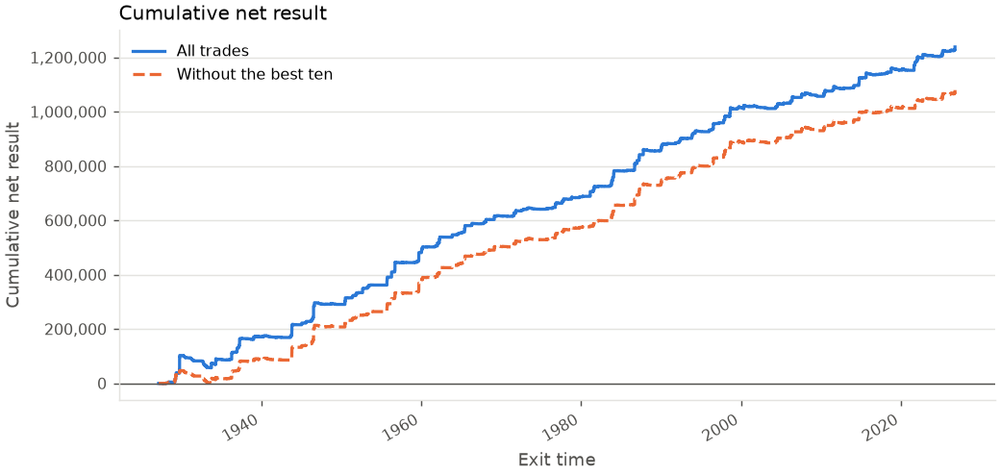
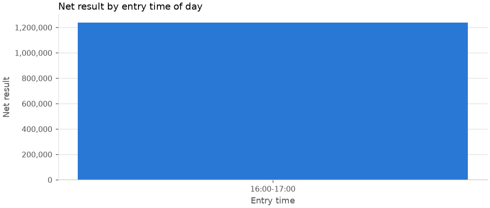
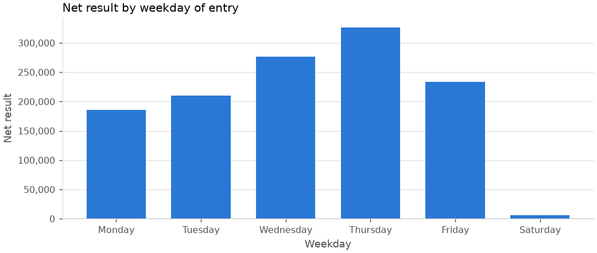
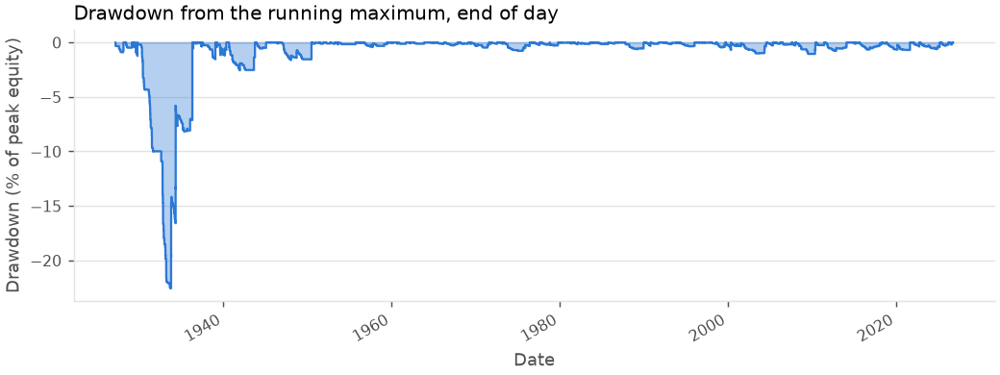

# Coroner report: industry_ma200.csv

## Verdict

3,230 trades made 1,238,279.87 net, a mean of 383.37 per trade with a t-statistic of 12.56, which is more than two standard errors from zero. Ten trades carry 13% of the profit, against a median of 5% for logs drawn from a Normal with the same mean and spread (p = 0.0005): the other 3,220 made 1,079,389.98 between them. The first half of the trades made 708,754.77 and the second half made 529,525.10.

## Input

File `industry_ma200.csv`: 3,230 trades, first entry 1927-03-03 16:00, last exit 2026-09-30 16:00.

Clock: timestamps without offset, used as written. Trades are ordered by exit time.

Starting capital 100,000.00 (set with `--capital`). Percentage drawdowns, the ulcer index and the Martin ratio depend on it.

## Per-trade result

The t-statistic is mean / standard deviation x sqrt(number of trades), with the n - 1 standard deviation. It treats trades as independent draws.

The clustered t-statistics use a cluster-robust standard error: trades that exit on the same day (or in the same month) may be correlated in any way, and the days (months) are taken as independent. With few clusters the clustered standard error is itself noisy.

|  | Trades | Total | Mean | Std dev | t-statistic |
|:--|--:|--:|--:|--:|--:|
| Net | 3,230 | 1,238,279.87 | 383.37 | 1,735.14 | 12.56 |
| Gross | 3,230 | 1,270,579.87 | 393.37 | 1,735.14 | 12.88 |

| Net, t-statistic | Clusters | t-statistic |
|:--|--:|--:|
| Trades independent | 3,230 | 12.56 |
| Clustered by exit day | 2,577 | 11.10 |
| Clustered by exit month | 799 | 8.34 |

## Without the best trades

Trades are ranked by net result and the best are removed. Share of profit is the removed trades' total over the total of all trades.

Smallest number of best trades whose removal takes the total to zero or below: **221** of 3,230.

|  | Removed | Removed total | Share of profit | Remaining total | Remaining mean | Remaining t |
|:--|--:|--:|--:|--:|--:|--:|
| All trades | 0 | 0.00 | 0.0% | 1,238,279.87 | 383.37 | 12.56 |
| Without best 10 | 10 | 158,889.89 | 12.8% | 1,079,389.98 | 335.21 | 12.71 |
| Without best 5% | 162 | 1,078,438.49 | 87.1% | 159,841.38 | 52.10 | 5.06 |

## Is that more concentrated than chance?

Each row draws 2,000 logs of 3,230 trades under a null and computes the same two numbers. The Normal null keeps the mean and standard deviation and has thin tails and no skew. The reflected null resamples these trades and flips each one about the mean with a random sign, which keeps the tails and removes the skew. p is one-sided: the share of draws at least as concentrated as this log, counting the log itself.

A draw whose total is zero or below counts as fully concentrated. Normal, same mean and std dev: 0 such draws; Trades resampled and reflected about the mean: 0 such draws.

|  | Share in best 10 | 95th pct | p | Trades to zero | 5th pct | p |
|:--|--:|--:|--:|--:|--:|--:|
| This log | 12.8% |  |  | 221 |  |  |
| Normal, same mean and std dev | 4.6% | 5.3% | 0.0005 | 374 | 317 | 0.0005 |
| Trades resampled and reflected about the mean | 11.3% | 13.2% | 0.0905 | 677 | 543 | 0.0005 |

## First half against second half

Trades in exit-time order, split by count: the first n // 2 and the rest.

|  | Trades | Total | Mean | Std dev | t-statistic |
|:--|--:|--:|--:|--:|--:|
| First half | 1,615 | 708,754.77 | 438.86 | 1,902.05 | 9.27 |
| Second half | 1,615 | 529,525.10 | 327.88 | 1,548.97 | 8.51 |

## Time of day

Buckets of 60 minutes by entry time.

A bucket is flagged when its median hold is under 5 minutes and it has at least 20 trades. Results from trades held that briefly depend heavily on the fill and cost assumptions behind them.

Permutation test: not run, all trades fall in one time-of-day bucket.

| Entry time | Trades | Net | Mean | Share of profit | Winners | Median hold (min) | Flag |
|:--|--:|--:|--:|--:|--:|--:|--:|
| 16:00-17:00 | 3,230 | 1,238,279.87 | 383.37 | 100.0% | 24.2% | 10,080.0 |  |

## Weekday

By weekday of entry.

Permutation test, weekday labels shuffled 2,000 times across 6 buckets: p = 0.1619. A small p means results differ across buckets more than chance would give.

| Weekday | Trades | Net | Mean | Share of profit | Winners | Median hold (min) | Flag |
|:--|--:|--:|--:|--:|--:|--:|--:|
| Monday | 531 | 185,813.65 | 349.93 | 15.0% | 23.5% | 10,080.0 |  |
| Tuesday | 654 | 210,073.21 | 321.21 | 17.0% | 23.4% | 10,080.0 |  |
| Wednesday | 696 | 276,923.49 | 397.88 | 22.4% | 27.3% | 11,520.0 |  |
| Thursday | 620 | 326,243.77 | 526.20 | 26.3% | 25.6% | 10,080.0 |  |
| Friday | 651 | 233,304.89 | 358.38 | 18.8% | 22.1% | 14,400.0 |  |
| Saturday | 78 | 5,920.86 | 75.91 | 0.5% | 15.4% | 5,760.0 |  |

## Costs

Cost is gross minus net, summed over all trades. Cost share is cost over gross.

|  | Amount |
|:--|--:|
| Gross result | 1,270,579.87 |
| Cost | 32,300.00 |
| Net result | 1,238,279.87 |
| Cost share of gross | 2.5% |

## Drawdown

The ulcer index and Martin ratio use end-of-day equity on every calendar day from the first exit to the last. Maximum drawdown, time under water and recovery factor use the trade-by-trade equity curve.

The annualised return is compound, on 365.25 days a year, and is not computed for logs shorter than 30 days.

Recovery factor is net profit over maximum drawdown. It is a trading-platform convention, not a statistic from the literature.

|  | Value |
|:--|--:|
| Ulcer index (%) | 2.921 |
| Annualised return (%) | 2.64 |
| Martin ratio | 0.90 |
| Maximum drawdown | 45,635.80 |
| Maximum drawdown (% of peak) | 22.55 |
| Longest time under water | 2,373 days 0 h |
| Recovery factor | 27.13 |

## Positive periods

Net result by exit date. Only periods with at least one closed trade are counted.

|  | Positive | Total | Share |
|:--|--:|--:|--:|
| Days | 607 | 2,577 | 23.6% |
| Months | 282 | 799 | 35.3% |
| Quarters | 175 | 349 | 50.1% |

## Target before loss limit

Target +10,000.00, loss limit -10,000.00, horizon 3,230 trades. Trades are resampled into paths and each path's running total is followed until it reaches a barrier or the horizon ends.

The closed form uses the per-trade mean and standard deviation and has no horizon, so it gives no weight to paths that reach neither barrier.

Resampling assumes future trades look like these ones, including the best of them arriving as often as they did here.

|  | Target first | Loss limit first | Neither | Paths |
|:--|--:|--:|--:|--:|
| i.i.d. bootstrap | 100.0% | 0.0% | 0.0% | 10,000 |
| Stationary bootstrap, mean block 10 | 97.6% | 2.4% | 0.0% | 10,000 |
| i.i.d. bootstrap without best 10 | 100.0% | 0.0% | 0.0% | 10,000 |
| Brownian closed form, no horizon | 92.7% | 7.3% |  |  |

## By symbol

| Symbol | Trades | Net | Mean | Share of profit | Winners | Median hold (min) |
|:--|--:|--:|--:|--:|--:|--:|
| Durbl | 310 | 152,163.73 | 490.85 | 12.3% | 21.9% | 10,080.0 |
| HiTec | 361 | 139,422.53 | 386.21 | 11.3% | 22.4% | 10,080.0 |
| Manuf | 293 | 133,101.86 | 454.27 | 10.7% | 29.4% | 17,280.0 |
| Enrgy | 338 | 130,651.11 | 386.54 | 10.6% | 22.5% | 11,520.0 |
| Utils | 272 | 124,441.21 | 457.50 | 10.0% | 27.2% | 11,520.0 |
| Shops | 334 | 120,256.68 | 360.05 | 9.7% | 24.6% | 10,080.0 |
| Hlth | 345 | 119,061.08 | 345.10 | 9.6% | 24.3% | 10,080.0 |
| Other | 319 | 115,243.28 | 361.26 | 9.3% | 25.7% | 10,080.0 |
| NoDur | 334 | 107,344.68 | 321.39 | 8.7% | 26.3% | 12,960.0 |
| Telcm | 324 | 96,593.71 | 298.13 | 7.8% | 19.1% | 8,640.0 |

## By side

| Side | Trades | Net | Mean | Share of profit | Winners | Median hold (min) |
|:--|--:|--:|--:|--:|--:|--:|
| long | 3,230 | 1,238,279.87 | 383.37 | 100.0% | 24.2% | 10,080.0 |

## Settings

coroner 0.1.0. Seed 0, 2,000 permutation draws, 10,000 bootstrap paths, best-n 10, risk-free rate 0% a year. The same file and settings give the same report.
